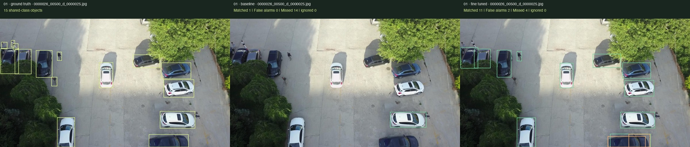

# Overwatch
### Aerial object detection with YOLO11n

Fine-tuning a general-purpose detector for drone imagery—and measuring what improves, what regresses, and what remains difficult.

**[Explore the live project →](https://overwatch-aerial.pages.dev/)** · **[Compare predictions](https://overwatch-aerial.pages.dev/#imagery)** · **[Evaluation protocol](docs/EVALUATION.md)**

**Python · PyTorch · YOLO11n · pycocotools · JavaScript · Cloudflare Pages**

This repository contains the interactive project website, exported results, and error-analysis artifacts. The training pipeline and model checkpoints are maintained separately and are not included here.

## Result at a glance

**Shared-class mAP@0.5 increased from 2.21% to 15.09% (+12.88 percentage points)** on **1,610 held-out test images**.

| Final test metric | COCO-pretrained | VisDrone fine-tuned | Change |
| :--- | ---: | ---: | ---: |
| mAP@0.5 | 2.21% | **15.09%** | **+12.88 pp** |
| mAP@0.5:0.95 | 1.29% | **7.57%** | **+6.28 pp** |
| Small-object AP | 0.21% | **1.76%** | **+1.54 pp** |

Both models used the same test images, six shared categories, and frozen inference settings. These are project COCO-style scores, not official VisDrone leaderboard results. AP is a detection metric, not a simple percentage of objects detected correctly.

## See the difference



**Left:** ground truth · **Center:** pretrained · **Right:** fine-tuned

On this fixed validation frame, matched objects increase **1 → 11**, with false alarms increasing **0 → 2**, at confidence ≥ 0.25 and matching IoU ≥ 0.5. This is an illustrative example, not an average-performance claim. The [interactive gallery](https://overwatch-aerial.pages.dev/#imagery) includes **12 cases**, including frames where fine-tuning performs worse.

## Engineering work

- **Dataset preparation:** converted VisDrone annotations for training and COCO-style evaluation, with explicit handling of ignored regions.
- **Fair comparison:** mapped COCO and VisDrone into six shared categories; reported the fine-tuned model’s ten-class results separately.
- **Recoverable training:** trained for 50 epochs with a fixed seed, saved Drive checkpoints, and verified optimizer-state recovery after interruption.
- **Reproducible evaluation:** recorded configurations, software versions, model hashes, and prediction hashes; kept the final test separate from development.
- **Error analysis:** reused saved validation predictions to inspect misses, false alarms, regressions, and class confusion without repeating final-test inference.
- **Presentation:** built a responsive, static comparison viewer and automated deployment from GitHub to Cloudflare Pages.

## Experiment

| Item | Configuration |
| :--- | :--- |
| Model | COCO-pretrained YOLO11n → VisDrone fine-tuning |
| Training | 6,471 images · 50 epochs · Colab NVIDIA T4 |
| Development | 548 validation images |
| Final evaluation | 1,610 test-dev images · frozen epoch-50 checkpoint |
| Shared classes | Person, bicycle, car, truck, bus, motorcycle |
| Inference | 320px · confidence 0.001 · native class-aware NMS IoU 0.7 |
| Scoring | pycocotools · detection caps of 3,000 · no observed truncation |

[Full final results](dist/assets/final-results.md) · [Comparison CSV](dist/assets/final-comparison.csv) · [Ten-class CSV](dist/assets/final-ten-class.csv) · [Evaluation settings](dist/assets/evaluation-settings.yaml)

## What the results do—and don’t—show

Fine-tuning improved AP across all six shared categories, with the largest gains for cars and buses. Small objects and bicycles remain difficult.

At a **fixed 0.25 confidence cutoff on validation**, recall rises **5.54% → 25.28%**, while precision falls **77.58% → 67.57%**. The model finds more objects but also produces more false alarms. These operating-point diagnostics use a different image set and threshold from the final-test AP table above.

This is a **single-seed, offline detection experiment**. It does not establish statistical significance, real-time performance, or readiness for onboard deployment. Future experiments would evaluate higher resolution, tiled inference, validation-based threshold calibration, and multiple training seeds. The consumed final test must not be reused to tune those changes.

[Detailed error analysis](dist/assets/m6-README.md) · [Case selection manifest](dist/assets/m6-cases.csv) · [Download annotated gallery](dist/assets/validation-gallery.zip)

## Repository guide

```text
dist/
  index.html          Project overview, results, and comparison viewer
  style.css           Responsive layout and visual design
  app.js              Interactive prediction overlays
  gallery.json        Saved predictions and annotations for 12 cases
  assets/             Dataset examples, metrics, plots, and gallery download
docs/
  EVALUATION.md       Protocol, interpretation, and reproducibility scope
  DEVELOPMENT.md     Local preview and deployment instructions
  ATTRIBUTION.md     Dataset and tool acknowledgments
  images/            README comparison image
```

## Run the website locally

No package installation or build step is needed. With Python 3 installed:

```sh
git clone https://github.com/zxcv616/overwatch-site.git
cd overwatch-site
python3 -m http.server 8765 --bind 127.0.0.1 --directory dist
```

Open **http://localhost:8765**. Serve the folder over HTTP; the viewer loads its data with `fetch`.

Cloudflare Pages deploys `dist/` automatically when `main` changes. [Development and deployment details →](docs/DEVELOPMENT.md)

## Acknowledgments

Imagery and annotations come from [VisDrone](https://github.com/VisDrone/VisDrone-Dataset). The experiment uses [Ultralytics YOLO](https://github.com/ultralytics/ultralytics), [PyTorch](https://pytorch.org/), and [COCO API / pycocotools](https://github.com/cocodataset/cocoapi). See [attribution and reuse notes](docs/ATTRIBUTION.md).
